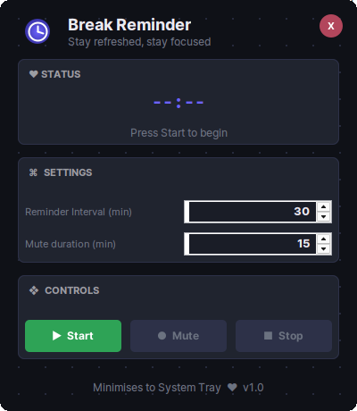

# ☕ Break Reminder (Don't Forget to Take break anymore !!!)

A lightweight Java 8 desktop app that runs in the Windows system tray and reminds you to take regular breaks.


#### Note : Vibe Coded, In-Development - Bugs may exist - Use with caution - Report Bugs and Feature Requirements!!!
    

## ❤️ Support This Project

If you enjoy using this software, you can support
its continued development!

### 🍕 Buy Me a Pizza  
<a href="https://buymeacoffee.com/sahasrarachakra?l=en">
  
</a>


## If you are an Indian Supporter
### 🇮🇳 Support via UPI

Scan this QR code using Google Pay, PhonePe or Paytm.


Thank you for supporting open-source development!

---
## Screenshot


## Features

| Feature | Detail |
|---|---|
| **Configurable interval** | 1 – 240 minutes (default 30) |
| **Countdown timer** | Live MM:SS display in the control window |
| **Modern alert dialog** | Always-on-top popup with auto-close (10 s) |
| **Snooze** | Snooze an alert for 5 minutes from the dialog |
| **Mute** | Silence reminders for a set duration (1–120 min, default 15) |
| **Stop** | End reminders for the session |
| **System Tray** | Minimises to tray; right-click menu; "Alert Now" option |
| **No installer** | Single JAR, pure Java 8 |

---

## Requirements

- **Java 8** (JRE or JDK) — [Download](https://adoptium.net/)
- Windows 7 / 10 / 11

Verify your Java version:
```
java -version
```

---

## Quick Start

### 1. Build and run (first time)
```
build_and_run.bat
```
This compiles the source, creates `BreakReminder.jar`, and launches the app.

### 2. Run (subsequent times)
```
run.bat
```
Or double-click `BreakReminder.jar` if `.jar` files are associated with Java.

---

## How to Use

1. **Set interval** – Use the "Reminder interval" spinner (minutes).
2. **Set mute duration** – How long the Mute button silences alerts.
3. **▶ Start** – Begins the countdown from the moment you click.
4. **🔕 Mute** – Silences for the configured mute duration; click again to unmute early.
5. **■ Stop** – Cancels all reminders for the day.
6. The window can be **dragged** anywhere on screen and **closed** (X) to minimise to tray.
7. **System tray** – right-click the clock icon for Open / Alert Now / Quit.

---

## Optional: Run on Windows Startup

1. Press `Win + R`, type `shell:startup`, press Enter.
2. Create a shortcut to `run.bat` in that folder.

---

## Project Structure

```
BreakReminder/
├── src/
│   └── BreakReminder.java   ← single-file source
├── build_and_run.bat        ← compile + launch
├── run.bat                  ← launch only
└── README.md
```

---

## License

MIT — free to use and modify.
